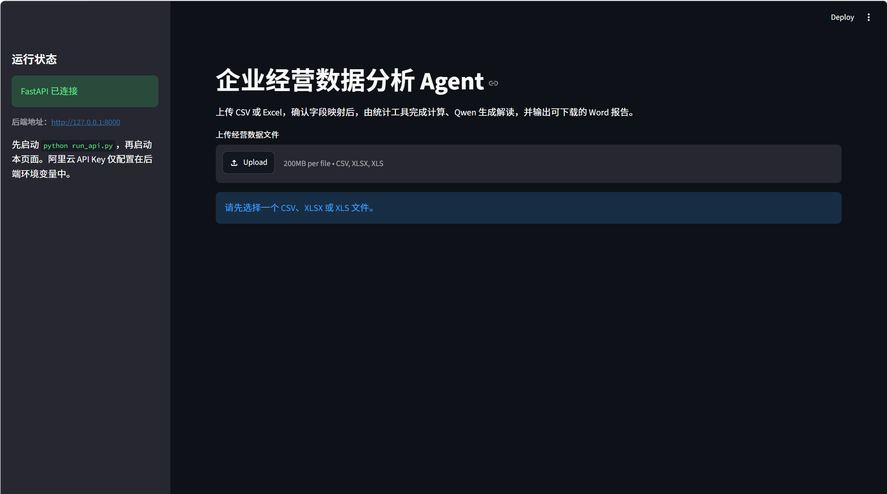
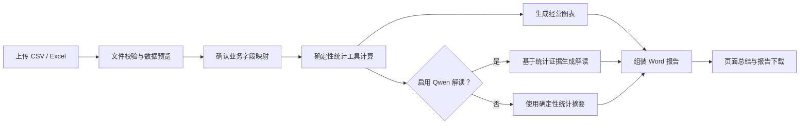
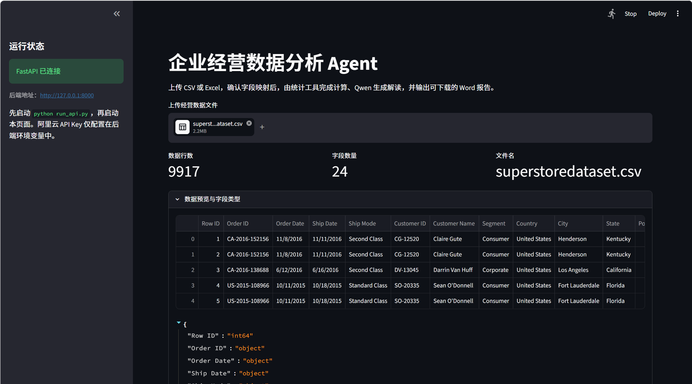
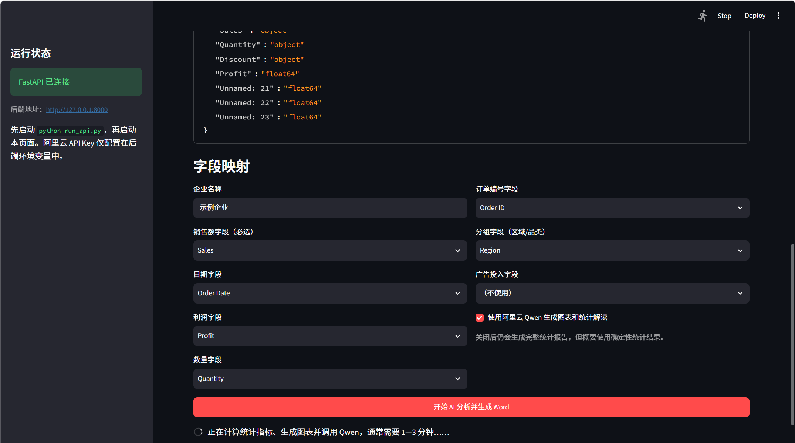
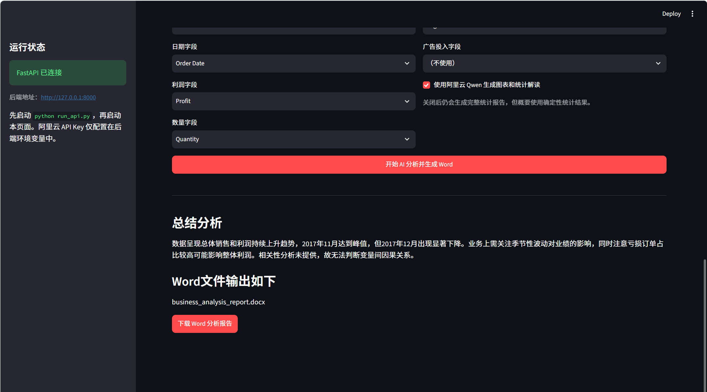
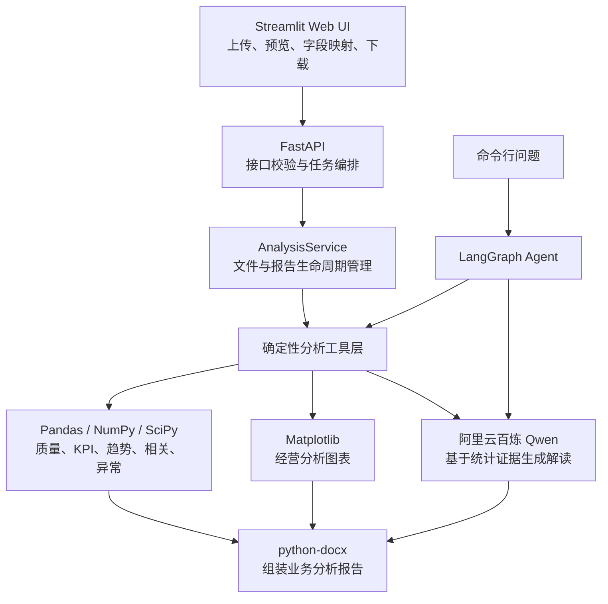
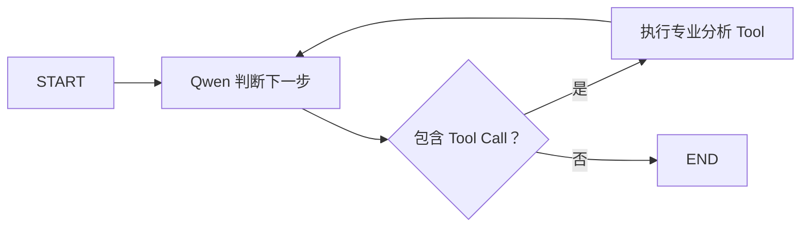

# 企业经营数据分析 Agent

一个面向 CSV / Excel 经营数据的智能分析应用：上传数据、确认业务字段，系统以确定性统计工具完成数据质量检查与指标计算，再由阿里云百炼 Qwen 基于计算结果生成业务解读，最终交付包含图表、结论和管理建议的 Word 报告。

> 核心原则：**统计工具负责事实，LLM 负责解释。** 销售额、利润率、趋势、相关系数和异常值均由 Pandas / NumPy / SciPy 计算，避免让大模型直接推算数值。



## 核心能力

- **数据接入**：支持 `.csv`、`.xlsx`、`.xls`，自动读取行列规模、字段类型并展示数据预览。
- **灵活字段映射**：将不同企业的数据字段映射为销售额、利润、数量、日期、订单编号、分组维度和广告投入。
- **数据质量检查**：识别缺失值、重复记录和问题字段，为后续分析提供质量依据。
- **经营指标计算**：输出总销售额、平均订单金额、总利润、利润率等确定性 KPI。
- **统计分析**：覆盖描述统计、时间趋势、分组表现、Pearson 相关分析和 Z-score 异常检测。
- **图表生成**：自动生成销售趋势图、分组销售图、相关性散点图和月度箱线图。
- **AI 业务解读**：Qwen 根据结构化统计证据总结表现、风险与管理建议；可关闭 LLM，使用纯统计模式生成报告。
- **Word 报告交付**：自动汇总执行摘要、数据质量、KPI、趋势、异常、图表和建议，支持网页直接下载。
- **LangGraph Agent**：提供独立的命令行分析入口，由模型按问题自主选择专业分析工具并循环调用。

## 产品流程



### 1. 数据预览

上传后端会保存带 UUID 的临时文件，返回数据规模、字段列表、字段类型和前 5 行预览。原始上传文件位于本地 `data/uploads/`，已通过 `.gitignore` 排除，不会进入代码仓库。



### 2. 字段映射与分析配置

销售额为必选字段；日期、利润、数量、订单编号、区域/品类和广告投入可按数据情况选填。系统会校验字段是否存在，并检查需要参与计算的字段是否包含可识别数值。



### 3. 总结与 Word 报告

分析完成后，页面展示管理摘要，并提供生成报告的下载入口。报告按任务 UUID 隔离存储在 `outputs/reports/`，其中包含 Word 文档及对应图表。



## 系统架构



Web 应用与 Agent 共用同一套专业工具：

| 分层 | 主要职责 |
| --- | --- |
| `frontend/app.py` | Streamlit 交互界面、API 状态检测、数据预览、字段映射和报告下载 |
| `backend/api/` | FastAPI 路由、请求/响应模型、错误转换和文件响应 |
| `backend/services/` | 上传文件管理、字段校验、分析任务与报告目录编排 |
| `backend/tools/` | 数据读取、质量检查、描述统计、KPI、趋势、相关性、异常、可视化和报告生成 |
| `backend/agent/` | Qwen 配置、LangGraph 状态、提示词、工具路由与循环调用 |

## 分析工具

| Tool | 作用 |
| --- | --- |
| `load_dataset` | 读取文件结构、字段与样本数据 |
| `check_data_quality` | 检测缺失值、重复记录和问题字段 |
| `descriptive_statistics` | 计算样本量、均值、中位数、标准差、分位数与极值 |
| `calculate_business_kpis` | 计算销售、订单、利润和利润率等经营 KPI |
| `analyze_time_trend` | 按时间聚合并判断整体趋势 |
| `analyze_correlation` | 计算 Pearson 相关系数、显著性与相关强度 |
| `detect_zscore_anomalies` | 使用 Z-score 定位异常期间 |
| `generate_business_charts` | 生成趋势、分组、散点和箱线图 |
| `generate_word_report` | 汇总统计结果、AI 解读、图表与管理建议并输出 DOCX |

## 快速开始

### 环境要求

- Python 3.10+
- 可访问阿里云百炼 OpenAI 兼容接口的网络环境
- 阿里云百炼 API Key（仅在启用 Qwen 解读或运行 LangGraph Agent 时需要）

### 1. 安装依赖

```powershell
git clone <your-repository-url>
cd Data_Analysis_Agent

python -m venv .venv
.\.venv\Scripts\Activate.ps1
python -m pip install --upgrade pip
python -m pip install -r requirements.txt
```

macOS / Linux 激活虚拟环境：

```bash
source .venv/bin/activate
```

### 2. 配置环境变量

PowerShell：

```powershell
Copy-Item .env.example .env
$env:DASHSCOPE_API_KEY = "你的阿里云百炼 API Key"
$env:DASHSCOPE_MODEL = "qwen2.5-14b-instruct"
$env:DASHSCOPE_BASE_URL = "https://dashscope.aliyuncs.com/compatible-mode/v1"
```

macOS / Linux：

```bash
export DASHSCOPE_API_KEY="你的阿里云百炼 API Key"
export DASHSCOPE_MODEL="qwen2.5-14b-instruct"
export DASHSCOPE_BASE_URL="https://dashscope.aliyuncs.com/compatible-mode/v1"
```

> `.env` 已被 Git 忽略。不要把真实 API Key 写入源码、README 或提交记录。当前程序直接读取进程环境变量；仅复制 `.env.example` 不会自动加载 `.env`。

可用配置：

| 环境变量 | 默认值 | 说明 |
| --- | --- | --- |
| `DASHSCOPE_API_KEY` | 无 | 阿里云百炼 API Key |
| `DASHSCOPE_MODEL` | `qwen3-8b` | Qwen 模型名称 |
| `DASHSCOPE_BASE_URL` | 百炼兼容接口 | OpenAI 兼容 API 地址 |
| `AGENT_TEMPERATURE` | `0` | 模型生成温度 |
| `DATA_AGENT_API_URL` | `http://127.0.0.1:8000` | Streamlit 访问的后端地址 |

### 3. 启动 Web 应用

打开第一个终端，启动 FastAPI：

```powershell
python run_api.py
```

后端默认运行于 `http://127.0.0.1:8000`，接口文档位于 `http://127.0.0.1:8000/docs`。

打开第二个终端并激活同一虚拟环境，启动 Streamlit：

```powershell
streamlit run frontend/app.py
```

浏览器访问 `http://localhost:8501`，即可上传文件并生成报告。后端当前允许 `.csv`、`.xlsx`、`.xls`，单文件最大 **25 MB**。

## 命令行 Agent

除固定的 Web 报告流程外，也可以直接向 LangGraph Agent 提出分析问题：

```powershell
python run_agent.py "D:\data\sales.xlsx" "先检查数据质量，再分析不同地区的销售额和利润表现"
```

执行流程：



Agent 默认设置递归上限为 12，并把实际工作流导出到 `graph.mmd`。它会根据问题选择一个或多个工具，再基于工具返回的计算结果形成回答。

## API 概览

| Method | Endpoint | 说明 |
| --- | --- | --- |
| `GET` | `/health` | 服务健康检查 |
| `POST` | `/api/v1/files/inspect` | 上传并解析 CSV / Excel，返回字段和预览 |
| `POST` | `/api/v1/analysis` | 提交字段映射，生成分析结果与 Word 报告 |
| `GET` | `/api/v1/reports/{job_id}/download` | 下载指定任务的 Word 报告 |

分析请求示例：

```json
{
  "upload_id": "上传接口返回的 UUID",
  "company_name": "示例企业",
  "sales_column": "Sales",
  "date_column": "Order Date",
  "profit_column": "Profit",
  "quantity_column": "Quantity",
  "order_id_column": "Order ID",
  "group_column": "Region",
  "advertising_column": null,
  "use_llm_interpretation": true
}
```

## Word 报告内容

生成的报告包含五个部分：

1. 执行摘要
2. 数据概览与质量
3. 描述统计与业务 KPI
4. 趋势、相关性、异常检测及经营图表
5. 管理建议

当启用 Qwen 时，模型仅接收结构化统计证据，并被要求区分业务解释与因果结论；相关性分析会明确提示“相关不代表因果”。如果关闭 Qwen 或单次解读失败，系统仍可基于确定性统计结果生成完整报告，并返回相应警告。

## 项目结构

```text
Data_Analysis_Agent/
├── backend/
│   ├── agent/                 # LangGraph、提示词与 Qwen 模型配置
│   ├── api/                   # FastAPI 路由和数据模型
│   ├── services/              # 上传、校验与报告任务编排
│   └── tools/                 # 统计分析、可视化与 DOCX 生成工具
├── frontend/
│   └── app.py                 # Streamlit Web 应用
├── data/
│   └── .gitkeep               # 本地上传目录占位；数据文件不提交
├── docs/
│   └── images/                # README 产品截图
├── outputs/                   # 本地生成报告；不提交
├── tests/                     # 工具层与 Agent 工作流测试
├── .env.example               # 环境变量示例
├── graph.mmd                  # LangGraph Mermaid 流程图
├── requirements.txt           # Python 依赖
├── run_agent.py               # 命令行 Agent 入口
└── run_api.py                 # FastAPI 启动入口
```

## 测试

```powershell
python -m pytest -q
```

现有测试覆盖：

- CSV 数据读取与结构识别
- 数据质量检查
- 基础销售分析
- LangGraph 工具调用与回到模型节点的路由
- Agent 工作流 Mermaid 导出

## 数据与安全

- API Key 只从环境变量读取，不应提交到 Git。
- 上传的经营数据和生成报告默认只保存在本机，并已被 `.gitignore` 排除。
- 上传文件使用 UUID 重命名，报告按任务 UUID 分目录存放。
- 下载接口会校验 UUID，避免直接使用任意文件路径。
- 当前版本面向本地运行；如需公网部署，应补充用户认证、访问授权、持久化存储、任务队列、文件生命周期清理、审计日志和更严格的 CORS 策略。

## 技术栈

`Python` · `FastAPI` · `Streamlit` · `LangGraph` · `LangChain` · `Qwen` · `Pandas` · `NumPy` · `SciPy` · `Matplotlib` · `python-docx`

